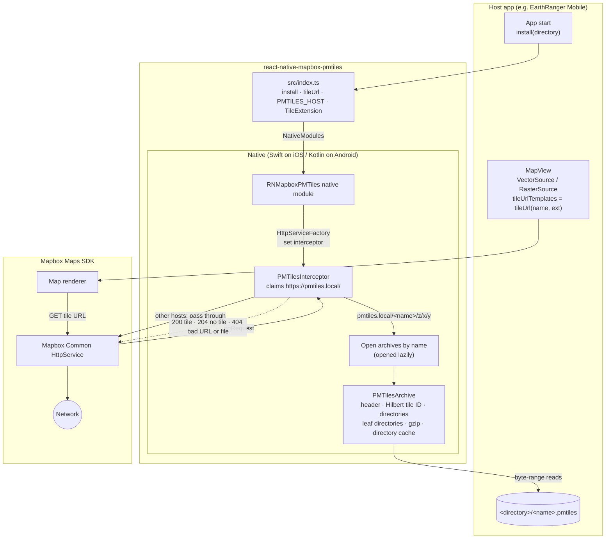
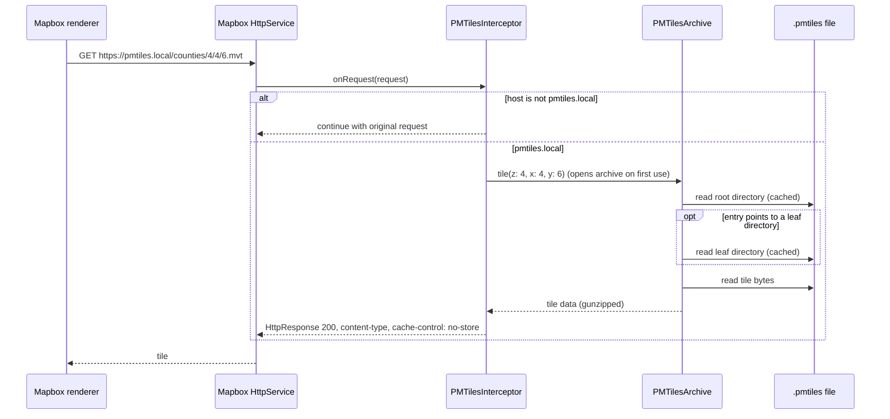
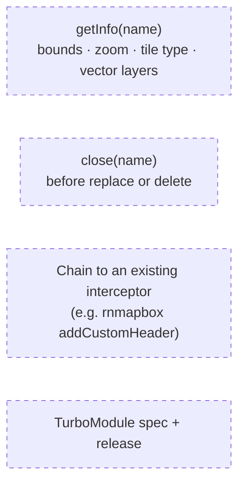

# Architecture

Serves tiles from local PMTiles files to Mapbox (`@rnmapbox/maps`) by intercepting Mapbox HTTP requests to a reserved host. No tile server and no changes to Mapbox.

Status: prototype. Vector PMTiles render on iOS and Android.

## Components

## Tile request

## Source layout

| Path | Role |
|---|---|
| `src/index.ts` | JS API: `install(directory)`, `tileUrl(name, ext)`, `PMTILES_HOST`, `TileExtension` type |
| `ios/RNMapboxPMTiles.swift`, `ios/RNMapboxPMTiles.m` | Native module; `install` registers the interceptor |
| `ios/PMTilesInterceptor.swift` | URL routing, archive registry, HTTP responses |
| `ios/PMTilesArchive.swift` | PMTiles v3 reader |
| `android/.../RNMapboxPMTilesModule.kt`, `RNMapboxPMTilesPackage.kt` | Native module and autolinked package |
| `android/.../PMTilesInterceptor.kt` | Same behaviour as iOS |
| `android/.../PMTilesArchive.kt` | Kotlin port of the Swift reader |
| `react-native-mapbox-pmtiles.podspec`, `android/build.gradle` | Depend on Mapbox Common supplied by `@rnmapbox/maps` |
| `test/fixtures/` | Shared PMTiles fixtures, `expected.json` and `generate.py` |
| `Package.swift`, `test/ios/PMTilesArchiveTests.swift` | XCTest for the Swift reader (`yarn test:ios`) |
| `android/src/test/.../PMTilesArchiveTest.kt` | JUnit test for the Kotlin reader (`yarn test:android`) |

## Planned

